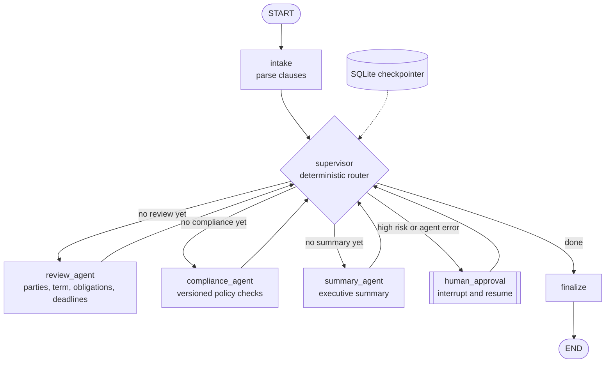

# Multi-Agent Legal Workflow

> A LangGraph supervisor that routes a contract through specialist review, compliance, and summary agents, then pauses for human approval when risk is high. State is checkpointed, so a paused review can be approved from a different process hours later.

[](https://github.com/gyaneshwarmalba/multi-agent-legal-workflow/actions/workflows/ci.yml)

Runs offline with rule-based agents (no API keys needed). Set `LLM_PROVIDER=bedrock` to have the agents use Claude on AWS Bedrock. Sample contracts are synthetic.

## Architecture



## How it works

| Agent | Responsibility | With an LLM |
|---|---|---|
| **Supervisor** | Picks the next agent with `route(state)`, a pure function of the current state | Never; routing stays deterministic |
| **Review** | Extracts parties, effective date, term, renewal, obligations ("X shall ..."), and notice periods, each tied to a section number | Asks Claude for strict JSON, validates the keys, and falls back to the rule-based extractor if the output is malformed (recorded as `rules-fallback`) |
| **Compliance** | Runs `policies/compliance_policy.json`: liability cap, mutual consequential-damages exclusion, no unilateral termination, data-use limits, 72-hour breach notice, no auto-renewal, payment terms of at least 30 days, approved governing law | Pass/fail stays rule-based; the LLM only adds a plain-language rationale for each failure |
| **Summary** | An executive summary built only from upstream outputs | Claude writes the prose from the same JSON facts |
| **Human approval** | `interrupt()` pauses the graph; `Command(resume=...)` continues it with `{approve, reviewer, note}` | n/a |

Reliability:

- **Retries.** Agent nodes have a LangGraph `RetryPolicy` (3 attempts, exponential backoff) that retries only `TransientLLMError`, which covers Bedrock throttling, timeouts, and 5xx errors.
- **Escalation instead of crashing.** Any other agent exception is recorded in `state.errors`. The supervisor then sends the run to a human, and it finishes with status `failed`.
- **Durable pauses.** The SQLite checkpointer means `run` and `resume` can happen in different processes.
- **Trace.** Every step is appended to `state.trace` with a timestamp, duration, and outcome. LangSmith tracing also works if enabled (see `.env.example`).

Results on the synthetic samples:

| Contract | Risk | Outcome |
|---|---|---|
| Acme MSA (one-sided) | high, 8 failed checks | Paused for approval |
| Globex mutual NDA | low | Auto-approved |
| Initech SaaS agreement | low, all checks pass | Auto-approved |

## Quick start

```bash
git clone https://github.com/gyaneshwarmalba/multi-agent-legal-workflow.git
cd multi-agent-legal-workflow
python -m venv .venv && source .venv/bin/activate
pip install -r requirements.txt

streamlit run app/main.py                     # UI: run a sample, inspect the agents, approve or reject

python -m app.cli run data/sample_contracts/acme_master_services_agreement.txt
# {"thread_id": "acme-master-services-agreement-1a2b3c4d", "status": "awaiting_approval", ...}
python -m app.cli resume acme-master-services-agreement-1a2b3c4d --reject --reviewer alice --note "renegotiate §8"
python -m app.cli show acme-master-services-agreement-1a2b3c4d -v   # full state and agent trace

pytest                                        # 17 tests, offline
```

## Configuration

| Variable | Default | Purpose |
|---|---|---|
| `LLM_PROVIDER` | `local` | `bedrock` uses Claude through the Bedrock Converse API (`pip install -r requirements-cloud.txt`) |
| `BEDROCK_MODEL_ID` | Claude 3.5 Sonnet | Any Converse-compatible model |
| `CHECKPOINT_DB` | `data/state/checkpoints.sqlite` | Workflow state |
| `COMPLIANCE_POLICY_PATH` | `policies/compliance_policy.json` | Policy checks and which risk levels require approval |

## Design decisions

- **A deterministic supervisor rather than LLM routing.** Legal workflows need reproducible paths and a clear audit trail. Using an LLM as the router adds cost, latency, and nondeterminism without adding value when the steps are known. LLMs are used where they help: extraction and prose.
- **Compliance verdicts are rules; explanations can be generated.** The approval gate depends on the pass/fail result, so that result must be repeatable for the same contract and policy version.
- **Validate model output and fall back.** Agent outputs are checked against a schema before they enter shared state, so one bad completion can't corrupt downstream agents.
- **One framework.** An earlier plan used both LangGraph and CrewAI. LangGraph alone covers stateful routing, interrupts, retries, and checkpointing, and a second framework would add overlap without new capability.

## Project layout

```
app/
  workflow.py        graph, supervisor route(), LegalWorkflow (start/resume/get)
  agents/review.py   extraction (rules + LLM with validation and fallback)
  agents/compliance.py  policy evaluation (require/prohibit/min_number/allowed_values)
  agents/summary.py  executive summary
  llm.py             Bedrock adapter, transient-error classification
  contracts.py       clause parsing
  cli.py             run / resume / show
  main.py            Streamlit UI
policies/compliance_policy.json
data/sample_contracts/
tests/
```

## License

MIT. See [LICENSE](LICENSE).
